# Scripts & Runtime Examples

Examples for shell scripts, sandboxed JavaScript, Python scripts, working directories, shell selection, and reproducible runtimes.

<div class="examples-grid">

<div class="example-card">

### Shell Scripts

```yaml
steps:
  - run: |
      #!/bin/bash
      cd /tmp
      echo "hello world" > hello
      cat hello
      ls -la
```

Run shell script with default shell.

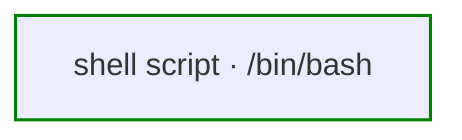

<a href="/writing-workflows/basics#scripts" class="learn-more">Learn more →</a>

</div>

<div class="example-card">

### JavaScript Scripts

```yaml
params:
  - name: TOTAL
    default: "1000"

steps:
  - id: batches
    action: js.run
    with:
      input:
        total: ${params.TOTAL}
        size: 300
      script: |
        const total = Number(input.total);
        const batches = [];
        for (let start = 0; start < total; start += input.size) {
          batches.push({ start, end: Math.min(start + input.size, total) });
        }
        return batches;
    output: BATCHES

  - id: export
    depends: [batches]
    foreach:
      items: ${BATCHES}
      max_concurrent: 2
      steps:
        - id: copy
          run: ./export.sh --from ${foreach.item.start} --to ${foreach.item.end}
```

Runs in Dagu's embedded JavaScript sandbox, so the DAG works on any host or worker without Node.js, Python, or a `tools:` entry. Syntax errors fail `dagu validate` before a run starts.

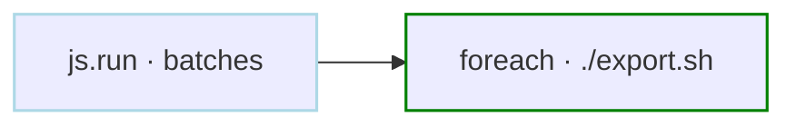

<a href="/step-types/js" class="learn-more">Learn more →</a>

</div>

<div class="example-card">

### Reshape Command Output

```yaml
steps:
  - id: pods
    run: kubectl get pods -o json

  - id: unhealthy
    depends: [pods]
    action: js.run
    with:
      input_file: ${pods.stdout}
      script: |
        return input.items
          .filter((pod) => !pod.status.containerStatuses?.every((c) => c.ready))
          .map((pod) => ({
            name: pod.metadata.name,
            phase: pod.status.phase,
            restarts: (pod.status.containerStatuses ?? [])
              .reduce((sum, c) => sum + c.restartCount, 0),
          }));
    output: UNHEALTHY
```

The CLI emits JSON and `js.run` filters and reshapes it. `input_file` reads the full stdout log, so large output does not pass through a variable.

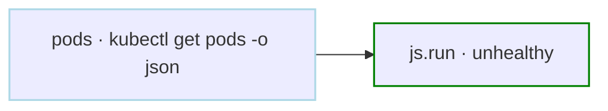

<a href="/step-types/js#input-from-earlier-steps" class="learn-more">Learn more →</a>

</div>

<div class="example-card">

### Parse Text Logs

```yaml
steps:
  - id: error_counts
    action: js.run
    with:
      input_file: /var/log/app.log
      format: text
      script: |
        const codes = [...input.matchAll(/level=error .*code=(\w+)/g)].map((m) => m[1]);
        const by_code = {};
        for (const code of codes) by_code[code] = (by_code[code] ?? 0) + 1;
        return { total: codes.length, by_code };
    output: ERRORS

  - id: report
    depends: [error_counts]
    run: echo "${error_counts.output.total} errors, ${error_counts.output.by_code.E_TIMEOUT} timeouts"
```

`format: text` binds the file as a string. One script replaces a `grep | awk | sort | uniq -c` pipeline, and later steps address the returned fields by path.

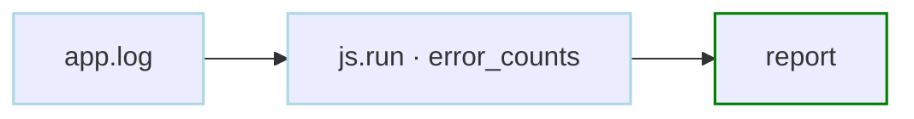

<a href="/step-types/js#configuration" class="learn-more">Learn more →</a>

</div>

<div class="example-card">

### Shebang Script

```yaml
tools:
  - astral-sh/uv@0.11.14

steps:
  - run: |
      #!/usr/bin/env -S uv run --python 3.13.9 python
      import platform
      print(platform.python_version())
```

Runs with the interpreter declared in the shebang.

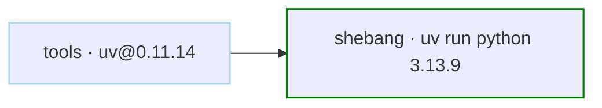

<a href="/writing-workflows/basics#scripts" class="learn-more">Learn more →</a>

</div>

<div class="example-card">

### Python Scripts

```yaml
tools:
  - astral-sh/uv@0.11.14

steps:
  - run: |
      import os
      import datetime
      
      print(f"Current directory: {os.getcwd()}")
      print(f"Current time: {datetime.datetime.now()}")
    with:
      shell: uv run --python 3.13.9 python
```

Execute script with specific interpreter. Use Python when the script needs its libraries. For data transforms, `js.run` needs no interpreter.

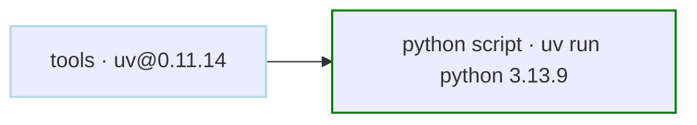

<a href="/writing-workflows/basics#scripts" class="learn-more">Learn more →</a>

</div>

<div class="example-card">

### Multi-Step Scripts

```yaml
steps:
  - run: |
      #!/bin/bash
      set -e
      
      echo "Starting process..."
      echo "Preparing environment"
      
      echo "Running main task..."
      echo "Running main process"
      
      echo "Cleaning up..."
      echo "Cleaning up"
```

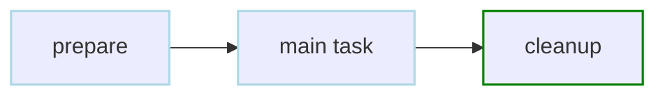

<a href="/writing-workflows/basics#scripts" class="learn-more">Learn more →</a>

</div>

<div class="example-card">

### Distributed Script Files

```yaml
steps:
  - id: generate_report
    run: bash scripts/report.sh config/report.yaml
    dependencies:
      - scripts/report.sh
      - config/report.yaml
```

Transfer a DAG-local script and its configuration when the workflow runs on a distributed worker.

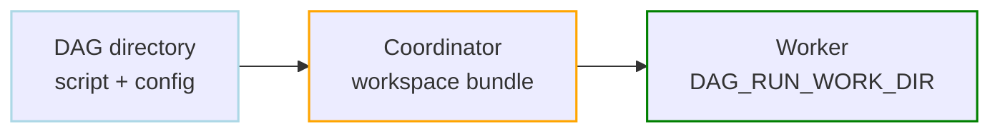

<a href="/writing-workflows/file-dependencies" class="learn-more">Learn more →</a>

</div>

<div class="example-card">

### Working Directory

```yaml
working_dir: /tmp
steps:
  - id: show_default_dir
    run: pwd               # Outputs: /tmp

  - id: create_data_dir
    run: mkdir -p data
    depends: show_default_dir

  - id: show_data_dir
    working_dir: /tmp/data
    run: pwd      # Outputs: /tmp/data
    depends: create_data_dir
```

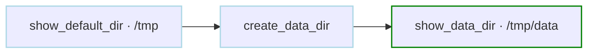

<a href="/writing-workflows/basics#working-directory" class="learn-more">Learn more →</a>

</div>

<div class="example-card">

### Shell Selection

```yaml
shell: /bin/bash             # Default shell for all steps
shell_args: ["-e"]           # Default shell args for all steps
steps:
  - run: echo hello world | xargs echo
  - run: echo "from zsh"     # Override for a single step
    with:
      shell: /bin/zsh
```

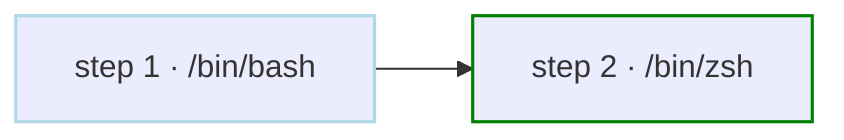

<a href="/writing-workflows/basics#shell" class="learn-more">Learn more →</a>

</div>

<div class="example-card">

### Reproducible Env with Nix Shell

> **Note:** Requires nix-shell to be installed separately. Not included in Dagu binary or container.

```yaml
steps:
  - run: |
      python3 --version
      curl --version
      jq --version
    with:
      shell: nix-shell
      shell_packages: [python3, curl, jq]
```

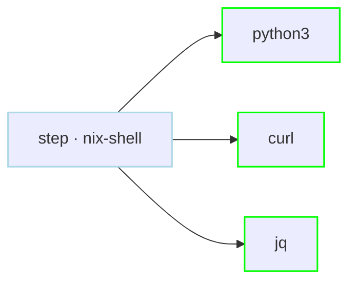

<a href="/step-types/shell#nix-shell" class="learn-more">Learn more →</a>

</div>

</div>
